# SQL Table Relations - CRM Data

## Project Overview

This project demonstrates how to query and analyze relational data using **SQL, SQLite, and Python Pandas**.

The lab focuses on working with multiple related database tables to retrieve, filter, aggregate, and analyze business data.

Through 10 SQL exercises, the project explores employee information, office locations, customer relationships, payments, product sales, and underperforming products.

SQL queries are executed against a SQLite database using Python's `sqlite3` library and Pandas' `read_sql()` method. The results are stored in Pandas DataFrames for inspection and analysis.

## Technologies Used

- **Python 3.10**
- **SQLite** — Relational database management
- **sqlite3** — Python's built-in SQLite database library
- **Pandas** — SQL query execution and DataFrame manipulation
- **pytest** — Automated testing

## SQL Concepts Covered

The following SQL concepts are demonstrated throughout the project:

| SQL Concept | Description |
|---|---|
| `SELECT` | Retrieves specific columns from a table |
| `INNER JOIN` | Returns records with matching values across related tables |
| `LEFT JOIN` | Returns all records from the left table, including unmatched records |
| `WHERE` | Filters records based on specified conditions |
| `IS NULL` | Identifies missing or unmatched values |
| `ORDER BY` | Sorts query results in ascending or descending order |
| `GROUP BY` | Groups records for aggregate calculations |
| `COUNT()` | Counts records or non-null values |
| `SUM()` | Calculates the total of numeric values |
| `AVG()` | Calculates the average of numeric values |
| `DISTINCT` | Eliminates duplicate values or records |
| `HAVING` | Filters grouped results based on aggregate conditions |
| `CAST()` | Converts values between SQL data types |
| Subqueries | Uses the results of one SQL query inside another |

## Project Structure

```text
sql-table-relations-lab/
├── main.py
├── data.sqlite
├── test_main.py
├── Pipfile
├── Pipfile.lock
└── README.md
```

**File Descriptions:**

- `main.py` — Contains the SQL queries and Pandas DataFrames.
- `data.sqlite` — SQLite database containing the relational tables.
- `test_main.py` — Automated tests validating the query results.
- `Pipfile` — Defines project dependencies and Python requirements.
- `Pipfile.lock` — Records locked dependency versions.
- `README.md` — Project documentation.

## Database Relationships

The project works with several related database tables:

- `employees` — Employee information and assigned office locations.
- `offices` — Office locations and associated details.
- `customers` — Customer contact information and assigned sales representatives.
- `orders` — Customer order records.
- `orderdetails` — Products and quantities associated with orders.
- `products` — Product information.
- `payments` — Customer payment records.

These tables are connected through primary and foreign key relationships.

For example:

```text
offices
   |
   | officeCode
   v
employees
   |
   | employeeNumber / salesRepEmployeeNumber
   v
customers
   |
   | customerNumber
   v
orders
   |
   | orderNumber
   v
orderdetails
   |
   | productCode
   v
products
```

## SQL Exercises

### Step 1: Find Employees Working in Boston

**Objective:** Retrieve the first and last names of employees working in the Boston office.

**SQL Concepts:**
- `INNER JOIN`
- `WHERE`

**Approach:**

Connect the `employees` and `offices` tables using `officeCode`, then filter for offices located in Boston.

**Result:** A DataFrame containing employees assigned to the Boston office.

### Step 2: Find Offices Without Employees

**Objective:** Identify offices that do not have any assigned employees.

**SQL Concepts:**
- `LEFT JOIN`
- `IS NULL`

**Approach:**

Use a `LEFT JOIN` to preserve all office records and filter for offices without matching employee records.

**Result:** A DataFrame containing office codes and cities for offices without employees.

### Step 3: Retrieve Employees and Office Locations

**Objective:** Display employees alongside their office city and state.

**SQL Concepts:**
- `LEFT JOIN`
- `ORDER BY`

**Approach:**

Connect employees with their office information while preserving employees without matching office records.

Sort the results alphabetically by first name and last name.

**Result:** A DataFrame containing employee names and office locations.

### Step 4: Identify Customers Without Orders

**Objective:** Find customers who have never placed an order.

**SQL Concepts:**
- `LEFT JOIN`
- `IS NULL`
- `ORDER BY`

**Approach:**

Connect customers with their orders and identify records without matching order numbers.

Sort the results by customer contact last name.

**Result:** A DataFrame containing customer contact information and assigned sales representatives.

### Step 5: Retrieve Customer Payment Information

**Objective:** Analyze customer payments and sort them by payment amount.

**SQL Concepts:**
- `INNER JOIN`
- `CAST()`
- `ORDER BY`

**Approach:**

Connect customer records with payment records using `customerNumber`.

Convert payment amounts to numeric values using `CAST(... AS REAL)` to ensure accurate sorting.

**Result:** A DataFrame containing customer contact names, payment amounts, and payment dates, sorted from highest to lowest payment amount.

### Step 6: Identify Sales Representatives with High-Credit Customers

**Objective:** Find sales representatives whose assigned customers have an average credit limit greater than 90,000.

**SQL Concepts:**
- `INNER JOIN`
- `COUNT()`
- `AVG()`
- `GROUP BY`
- `HAVING`

**Approach:**

Connect employees with their assigned customers.

Group customers by sales representative and calculate the number of customers and average credit limit.

Use `HAVING` to return only representatives whose customers have an average credit limit above 90,000.

**Result:** A DataFrame containing employee information and customer counts.

### Step 7: Analyze Product Sales

**Objective:** Calculate the number of order-detail records and total units ordered for each product.

**SQL Concepts:**
- `INNER JOIN`
- `COUNT()`
- `SUM()`
- `GROUP BY`
- `ORDER BY`

**Approach:**

Connect products with their order details.

Group records by product code and calculate total order-detail records and quantities ordered.

Sort the results by total units ordered in descending order.

**Result:** A DataFrame containing product names, order counts, and total units ordered.

### Step 8: Count Unique Customers Purchasing Each Product

**Objective:** Determine how many unique customers purchased each product.

**SQL Concepts:**
- Multiple `INNER JOIN` operations
- `COUNT(DISTINCT)`
- `GROUP BY`
- `ORDER BY`

**Approach:**

Connect the `products`, `orderdetails`, and `orders` tables.

Use `COUNT(DISTINCT orders.customerNumber)` to avoid counting customers multiple times when they purchase the same product in separate orders.

**Result:** A DataFrame containing product names, product codes, and unique customer counts.

### Step 9: Calculate Customer Counts by Office

**Objective:** Determine how many customers are assigned to each office.

**SQL Concepts:**
- Multiple `LEFT JOIN` operations
- `COUNT()`
- `GROUP BY`

**Approach:**

Connect offices with employees and their assigned customers.

Use `LEFT JOIN` to preserve offices that may have no employees or customers.

Group records by office code and calculate the total number of assigned customers.

**Result:** A DataFrame containing customer counts, office codes, and office cities.

### Step 10: Identify Employees Associated with Underperforming Products

**Objective:** Identify employees associated with sales of products purchased by fewer than 20 unique customers.

**SQL Concepts:**
- Multiple `INNER JOIN` operations
- Subqueries
- `WHERE IN`
- `COUNT(DISTINCT)`
- `GROUP BY`
- `HAVING`
- `SELECT DISTINCT`
- `ORDER BY`

**Approach:**

The solution uses a nested SQL query.

**Subquery:**

1. Connect products with order details and orders.
2. Group the records by product code.
3. Count the number of unique customers who purchased each product.
4. Filter for products purchased by fewer than 20 customers.

**Main Query:**

1. Connect employees with customers, orders, order details, and offices.
2. Filter orders using the product codes returned by the subquery.
3. Retrieve employee information and office locations.
4. Use `SELECT DISTINCT` to avoid duplicate employee records.
5. Sort employees alphabetically by last name.

**Result:** A DataFrame containing employee numbers, first names, last names, office cities, and office codes for employees associated with underperforming products.

## Installation and Setup

### 1. Clone the Repository

```bash
git clone <repository-url>
cd sql-table-relations-lab
```

Replace `<repository-url>` with your GitHub repository URL.

### 2. Install Dependencies

Ensure Python 3.10 and Pipenv are installed.

Install the project's dependencies:

```bash
pipenv install --dev
```

### 3. Activate the Virtual Environment

```bash
pipenv shell
```

### 4. Run the Application

Execute the SQL queries:

```bash
python main.py
```

By default, the project displays the results of the final subquery exercise.

To inspect other query results, uncomment the corresponding `print()` statement in `main.py`.

For example:

```python
print(df_boston)
```

## Running the Test Suite

The project includes automated tests using `pytest`.

Run all tests:

```bash
pytest
```

For detailed test results:

```bash
pytest -v
```

To stop execution after the first failure:

```bash
pytest -xv
```

The tests validate the structure and expected results of the SQL queries.

## Screenshots

The following screenshots can be added to demonstrate successful execution and testing.

### SQL Query Results

Screenshots showing the query for each step:

#### Step 1
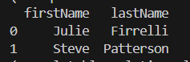
#### Step 2
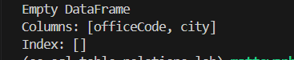
#### Step 3
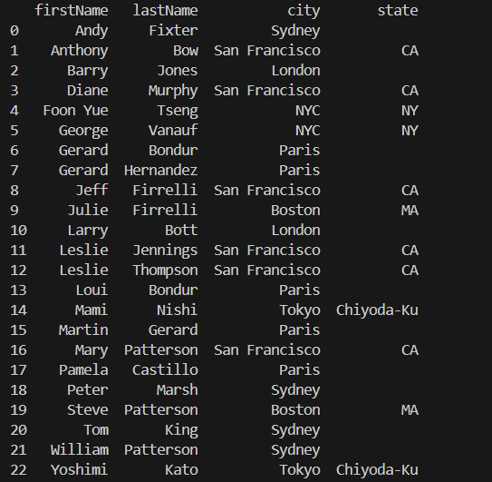
#### Step 4
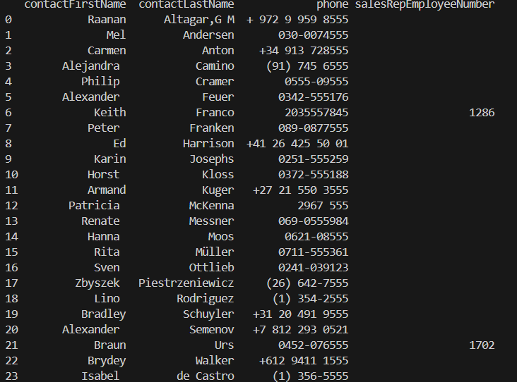
#### Step 5
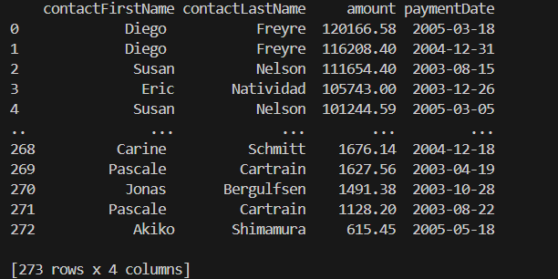
#### Step 6
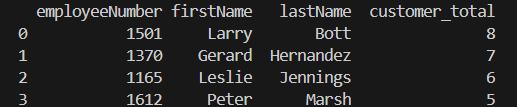
#### Step 7
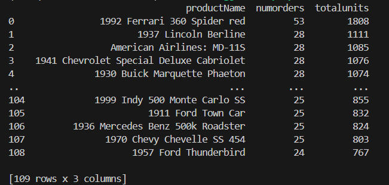
#### Step 8
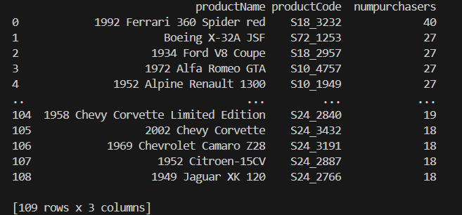
#### Step 9
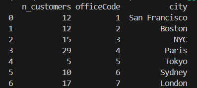
#### Step 10
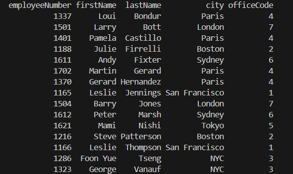

### Test Suite Results
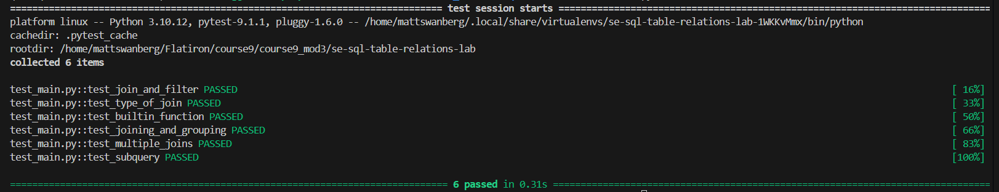

## Key Takeaways

This project reinforced several important relational database concepts:

1. **Understanding Table Relationships:** Learned how to connect multiple tables using primary and foreign keys.

2. **Choosing Appropriate JOIN Types:** Practiced using `INNER JOIN` for matching records and `LEFT JOIN` for preserving unmatched records.

3. **Filtering Missing Data:** Used `IS NULL` to identify offices without employees and customers without orders.

4. **Aggregating Business Data:** Applied `COUNT()`, `SUM()`, and `AVG()` to analyze customers, products, and payments.

5. **Filtering Aggregated Results:** Used `GROUP BY` and `HAVING` to identify records meeting specific aggregate conditions.

6. **Avoiding Duplicate Records:** Used `DISTINCT` and `COUNT(DISTINCT)` to ensure accurate results.

7. **Writing Subqueries:** Combined nested SQL queries to identify employees associated with underperforming products.

8. **Integrating SQL with Python:** Used Pandas DataFrames to execute and inspect SQLite query results.

9. **Testing and Debugging:** Used pytest to validate query outputs and troubleshoot SQL errors.

## Conclusion

The SQL Table Relations Lab demonstrates how relational database queries can be used to analyze business operations across multiple connected tables.

By combining SQL JOIN operations, filtering, aggregation, and subqueries, the project provides practical experience retrieving meaningful information from structured data.

The exercises also reinforce the importance of testing SQL queries, understanding database relationships, and documenting code for maintainability.

### Passing testing Suite

## Author

Created by Matthew Swanberg as part of Course 9 Module 3 (SQL Table Relations - CRM Data)